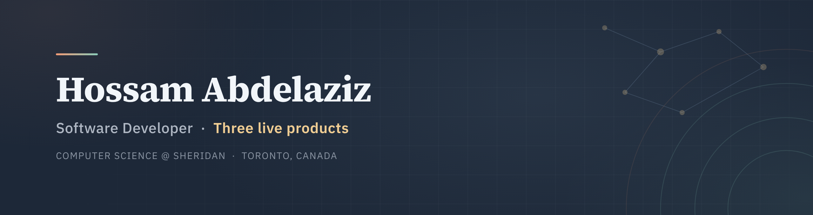

  

  
  
  
  

---

### About

Software developer. Computer Science (Mobile Computing) at **Sheridan College**, Ontario.

I build and run **three production products** through **North Via Tech**, my one-person studio — architecture, data model, web, mobile, payments, deployment and the support after launch.

> **Most of my repositories here are private**, because the code belongs to my clients.
> Architecture write-ups for each product live on [hossamabdelaziz.com](https://www.hossamabdelaziz.com).

---

### Live work

| Product | What it is | Where |
|---|---|---|
| **Recovery Space** | Bilingual Arabic/English coaching platform — programs, booking, daily check-ins, messaging | [Web](https://www.asmaagad.com) · [iOS](https://apps.apple.com/us/app/recovery-space-by-asmaa-gad/id6778065708) · [Android](https://play.google.com/store/apps/details?id=com.coachasmaa.recovery) |
| **FieldBase** | White-label field-service platform — deliveries, visits, tickets, warranties. In daily production use in Saudi Arabia and Egypt | `private · white-label` |
| **HOJ Rentals** | Vehicle rental booking with server-computed quotes and an admin panel | [hojrentals.ca](https://www.hojrentals.ca) |

---

### FixNext — Sheridan Datathon 2026, IBM “Before the Breach”

A model ranking IBM’s benchmark of **72,670 vulnerabilities** by how likely attackers are to exploit them.
Back-tested in time — train on 2024, predict 2025:

| Ranking | Found in top 500 |
|---|:--:|
| Highest CVSS first | 6 |
| EPSS first | 11 |
| Exploit code, then EPSS | 17 |
| **FixNext** | **19** |

Built in 24 hours with a team of four. Python · LightGBM · IBM Granite embeddings.
[Live dashboard](https://fixnext.select) · [Code](https://github.com/DavidRosales21/FixNext)

---

### Working with

  
  
  
  
  
  
  
  
  
  
  
  
  
  
  

---

This repository also holds the source for hossamabdelaziz.com.
